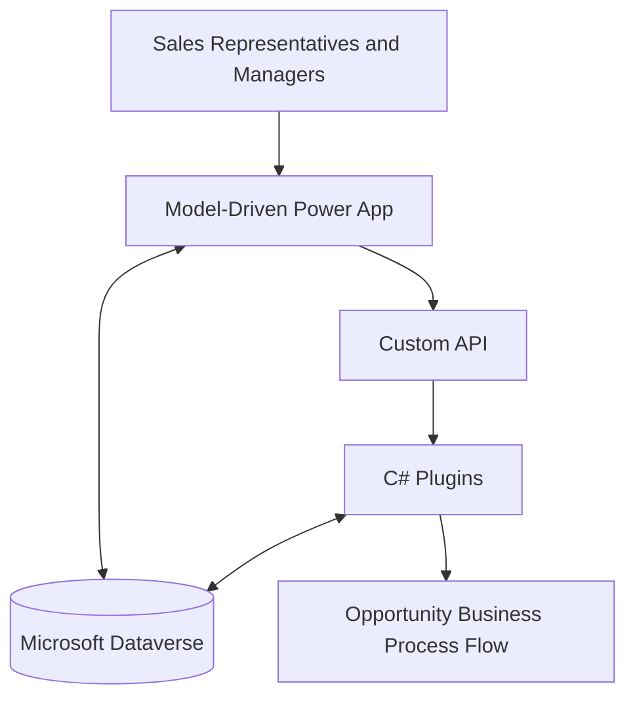

# VNEXT Internship CRM

An individual CRM implementation project developed as part of the **VNEXT Internship 2026**.

The project implements a sales-oriented CRM solution using Microsoft Power Platform and Microsoft Dataverse, with custom C# plugins enforcing server-side business logic.

## Architecture



### Implemented Components

- Model-driven Power App
- Dataverse data model and custom tables
- Custom security roles
- Lead qualification plugin (EXT10)
- Opportunity transition plugin (EXT11)
- `vn_TransitionOpportunity` Custom API
- Opportunity Sales Process BPF
- Custom forms, views, and dashboards

### Planned Integrations

- Power Automate
- Copilot Studio
- Power BI reporting
- PCF controls

## Technology Stack

| Technology | Purpose |
|---|---|
| Microsoft Power Platform | CRM platform |
| Microsoft Dataverse | Data storage and business logic platform |
| Power Apps | Model-driven application |
| Power Platform CLI | Environment and solution management |
| C# / .NET Framework 4.8 | Server-side plugins |
| Microsoft.Xrm.Sdk | Dataverse SDK |
| Git | Version control |

## Repository Structure

```text
VNEXTInternshipCRM/
├── data/                 # Synthetic development data
├── docs/                 # Architecture and project documentation
├── exports/              # Dataverse solution exports
├── src/
│   ├── Agents/            # Copilot Studio assets
│   ├── CustomAPIs/        # Custom API source assets
│   ├── Dataverse/         # Dataverse solution components
│   ├── Flows/             # Power Automate assets
│   ├── PCF/               # Power Apps Component Framework
│   ├── Plugins/           # C# plugin implementation
│   └── PowerBI/           # Power BI assets
└── tests/                 # Testing assets
```

## Plugin Architecture

The plugin implementation is organized into:

- **Lead:** Lead qualification logic.
- **Opportunity:** Opportunity lifecycle and stage transitions.
- **Common/Context:** Plugin execution context and service access.
- **Common/Services:** Authorization, Dataverse, and BPF services.
- **Common/Validation:** Shared validation logic.
- **Infrastructure:** Base plugin implementation.

## Development Environment

| Component | Configuration |
|---|---|
| Operating System | Windows 11 |
| Git | 2.56.0 |
| Power Platform CLI | 2.16.1 |
| Plugin Framework | .NET Framework 4.8 |
| Dataverse Environment | Development environment |

## Documentation

Project documentation is maintained under `docs/`:

- `architecture.md`
- `DEPLOYMENT.md`
- `environment-readiness.md`
- `m1-dataverse-foundation.md`
- `m2-security-configuration.md`
- `synthetic-data-policy.md`

## Security

- Never commit credentials, access tokens, or connection secrets.
- Do not use real customer data in development or demonstrations.
- Use synthetic data for development.
- Apply least-privilege access and role-based authorization.
- Review plugin execution identities and permissions before production deployment.

## Project Status

The Dataverse solution and core plugin components have been implemented and registered.

The solution has been exported as an unmanaged development package. Functional testing and final deployment